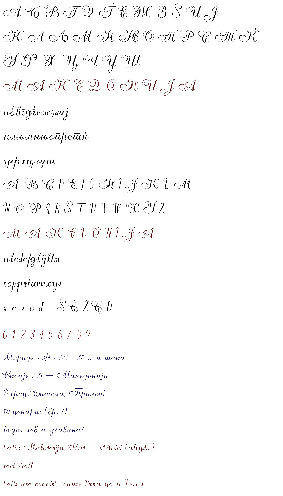

# Makedonka Cursive

A Macedonian cursive **display** font — all 31 Macedonian letters (upper + lowercase),
a full **Latin** alphabet, digits 0–9, and punctuation — in two weights, **Regular** and
**Bold**. The Macedonian letters are
vectorized from the Wikimedia chart *"Macedonian cursive script"* and spaced to **join at
the x-height**, so words read as a connected whole and lowercase tucks under a leading
capital's flourish. (True contextual joining — a v2 — is future work.)

**Version 0.9.40** — a font by **Goran Arsov**, derived from MacedonianBoy's cursive chart (CC BY-SA 3.0).
**Hinted** (PostScript + TrueType), with a contrast-preserving Bold, an **OpenType figures suite**
(tabular figures, slashed zero, super/subscripts, automatic fractions — type `1/2` → ½),
**South-Slavic Latin diacritics** (`š č ž ć đ` / `Š Č Ž Ć Đ`), and **math + symbols**
(`+ − = × ÷ < > ± № @ $ © # …`).



## Files

Each weight (**Regular**, **Bold**) ships in four formats:

| Format  | Use |
|---------|-----|
| `.otf`  | Desktop install (Word, LibreOffice, Photoshop…) and editing in FontForge/Glyphs |
| `.ttf`  | Desktop install — maximum compatibility (older apps, some embedded/Android) |
| `.woff2`| **Web** (primary — smallest, all modern browsers) |
| `.woff` | Web fallback (older browsers) |

Plus `makedonka-cursive.css` (ready `@font-face` rules for both weights), `demo.html`
(open in a browser), `specimen.png`, and `specimen.html` — a single self-contained specimen page with
both weights embedded, so it shows the real kerning and every OpenType feature without installing anything.

## Install on your computer (Word, LibreOffice, any app)

- **Windows:** select `MakedonkaCursive-Regular.otf` and `MakedonkaCursive-Bold.otf`,
  right-click → **Install** (or open each and click *Install*). Then pick
  **"Makedonka Cursive"** in Word / LibreOffice; the **Bold** button (Ctrl/⌘+B) gives the
  Bold weight.
- **macOS:** double-click each `.otf` → **Install Font** (Font Book).
- **Linux:** copy the `.otf` (or `.ttf`) files to `~/.local/share/fonts/`, then `fc-cache -f`.

Use the `.otf` by default; use the `.ttf` only if an app won't accept the `.otf`.

It's an ornate **copperplate display** face — use it **large** (headings, logos, titles,
hero text), not for body copy or small sizes. It covers all 31 **Macedonian** letters plus a
full **Latin** alphabet, digits and punctuation (see **Coverage** below).

## Use it on the web

Copy the `.woff2` + `.woff` (both weights) next to your CSS and import
`makedonka-cursive.css`, or inline:

```css
@font-face {
  font-family: "Makedonka Cursive";
  src: url("MakedonkaCursive-Regular.woff2") format("woff2"),
       url("MakedonkaCursive-Regular.woff") format("woff");
  font-weight: 400; font-style: normal; font-display: swap;
}
@font-face {
  font-family: "Makedonka Cursive";
  src: url("MakedonkaCursive-Bold.woff2") format("woff2"),
       url("MakedonkaCursive-Bold.woff") format("woff");
  font-weight: 700; font-style: normal; font-display: swap;
}

h1        { font-family: "Makedonka Cursive", cursive; }
h1.strong { font-weight: 700; }
```

(Rails: drop the web files in `public/fonts/` and reference `/fonts/…`, or put them in
`app/assets/fonts/` for the asset pipeline.)

**CDN (no download):** this public repo is served by **jsDelivr** automatically — pin a release tag:

```css
@font-face {
  font-family: "Makedonka Cursive";
  src: url("https://cdn.jsdelivr.net/gh/Goran-Arsov/makedonka-cursive@v0.9.40/MakedonkaCursive-Regular.woff2") format("woff2");
  font-weight: 400; font-display: swap;
}
```

## Coverage
- **Letters:** all 31 Macedonian letters, upper + lowercase (62 glyphs), with the correct
  Macedonian/Serbian-style cursive forms (overbarred г/п/т, g-shaped д, dotted ј, …).
- **Weights:** Regular + Bold (a faux-bold derived from the Regular by a **contrast-preserving** dilation —
  it weights the stems while keeping the hairlines, overbars and connectors delicate).
- **Digits:** 0–9, designed to match (calligraphic pen numerals; not in the source chart). They are
  **hybrid figures** — about 1.7× the x-height, clearly below the ascenders, so they sit with lowercase text
  ("31 letters") — and switch automatically to **cap-height lining figures** inside all-caps runs
  (`МАКЕДОНИЈА 2025`, `OHRID 1999`); the `case` feature forces the cap-height set.
- **Punctuation:** space `. , : ; ! ? ¡ ¿ - – — ( ) ' " „ " ‚ ‘ ’ « » ‹ › / … · • ° % `` ` `` — calligraphic
  pen marks, including the Macedonian `„ "` and `« »` quotes (designed to match; not in the source chart).
  A no-break space (U+00A0) is mapped too. Dashes and the math operators sit at a lowercase height between
  lowercase words (`воз-воз`, `upper + lowercase`) and rise automatically next to a figure or a capital
  (`2025-11-02`, `А–Б`, `1 + 2`); the `case` feature raises them all. Apostrophes and quotes sit just above the
  x-height, below the ascenders, and the letter after an apostrophe tucks under it (`it's`, `Let's`, `I'mma`,
  `rock'n'roll`, `‘quote’`).
- **Latin:** full A–Z / a–z, a calmer companion to the ornate Macedonian hand — one
  consistent, moderately upright slant across all letters, figures and punctuation, in a
  **restrained** pen style. Every Latin glyph is either drawn or a re-angled copy of a
  Cyrillic letter (the Macedonian glyphs themselves are unchanged). Good for names,
  wordmarks and short Latin text — not a full-flourish Latin script. Includes the
  **South-Slavic diacritics** `š č ž ć đ` / `Š Č Ž Ć Đ` (Croatian/Bosnian/Serbian-Latin, Slovenian).
- **Spacing & kerning:** letters join at the x-height, and built-in **GPOS kerning** evens the
  connections, tightens loose joins, and spaces consecutive capitals so **all-caps also reads**
  (the cap flourishes still cross, as a copperplate hand does). Applied to both weights.
- **OpenType features:** `tnum` tabular (uniform-width) figures · `zero` slashed zero · `sups`/`subs`
  superscripts & subscripts (H₂O, x²) · `numr`/`dnom` · `frac` automatic fractions (type `1/2` → ½) ·
  `calt` (on by default: cap-height figures and raised dashes/operators next to capitals and figures) ·
  `case` (all of those forced on, for all-caps settings).
  Turn them on in any OpenType-aware app (InDesign, Illustrator, Word's advanced typography) or on the
  web with CSS `font-feature-settings` / `font-variant`. Both weights carry a **STAT** table so the
  family groups correctly across apps.
- **Math & symbols:** `+ − = × ÷ < > ±` operators; `&` ampersand, `№` numero, `@` at, `$` dollar, `€` euro,
  `© ® ™`, `§ ¶`, `‰` per-mille, `′ ″` primes; the precomposed `½ ¼ ¾`, superscript `¹ ² ³ ⁰–⁹` and subscript
  `₀–₉` figures; and the ASCII set `# * _ | ~ \ ^ [ ] { }` — calligraphic pen forms.
- **Not included:** other-Cyrillic (Russian/Serbian-specific letters) and the Western-European accented
  Latin letters (À…ÿ) — the Latin set is for names and the South-Slavic languages.

## Scope & roadmap
- **A display face — use it large.** An ornate copperplate for headings, logos, titles and short text.
  It ships **hinted** (PostScript + TrueType grid-fitting), but the hairlines are intentionally delicate,
  so it isn't meant for long body copy at small sizes.
- **Fully connected joining is on the roadmap (v2).** The letters are spaced and kerned to read as
  connected cursive; true entry/exit joining strokes (OpenType `calt` with connected letterforms) are
  future work — they need the forms drawn by hand, so they're not auto-generated.

## License & attribution — **required**

**Makedonka Cursive** is by **Goran Arsov** (the digits, punctuation, Bold, the full Latin alphabet,
and all spacing/kerning/engineering). It is a **derivative work** of
[*"Macedonian cursive script"* by **MacedonianBoy**](https://commons.wikimedia.org/wiki/File:Macedonian_cursive_script.svg)
(Wikimedia Commons), whose Macedonian cursive letterforms it traces, licensed **Creative Commons
Attribution-ShareAlike 3.0 Unported (CC BY-SA 3.0)**. Therefore:

- You **must keep attribution** to MacedonianBoy and the CC BY-SA 3.0 license wherever you
  distribute or ship the font (a credits/colophon page, a CSS comment, or an "about" note is
  fine). The attribution is also embedded in the font's metadata.
- You **must license the font (and modified versions) under CC BY-SA 3.0** — it cannot be
  made proprietary or sold under closed terms. Others may reuse and modify it under the same
  license (including commercially).

See `LICENSE`. Full license text: https://creativecommons.org/licenses/by-sa/3.0/

*(This is a practical summary of the license terms, not legal advice.)*
